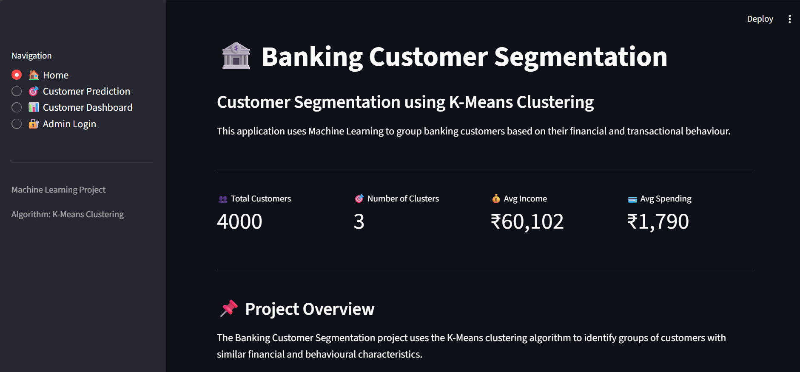
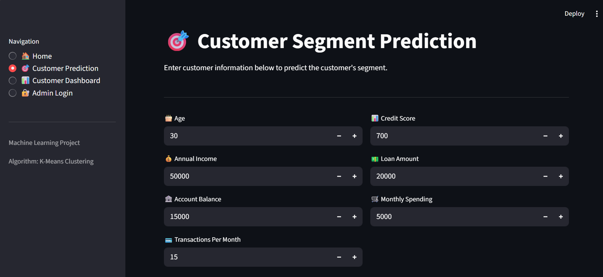
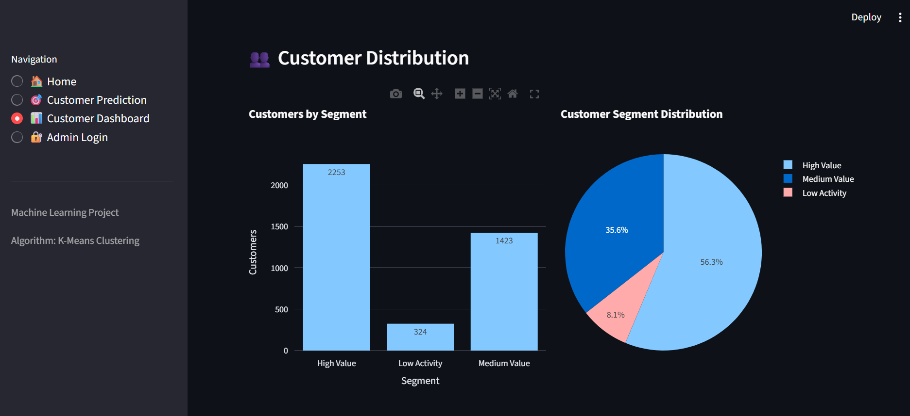
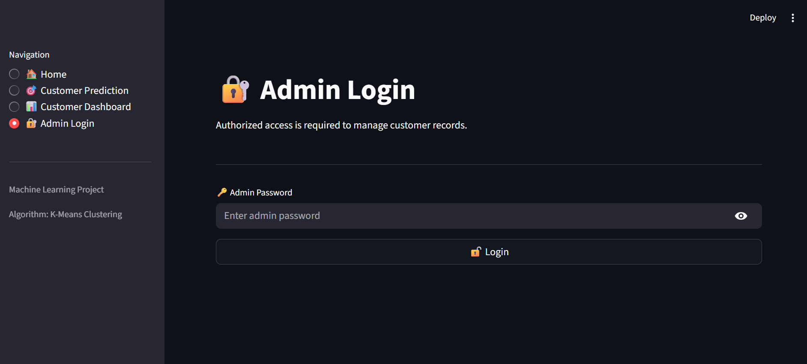

# 🏦 Banking Customer Segmentation Using K-Means

A Machine Learning project that groups banking customers into meaningful segments based on their financial behavior and banking activity. The project uses **K-Means Clustering** and provides an interactive **Streamlit web application** for customer prediction, visualization, and management.

## 📌 Project Overview

Banks serve customers with different income levels, account balances, transaction patterns, loan amounts, and spending habits. Understanding these differences helps banks make better business decisions and improve customer engagement.

This project applies the K-Means clustering algorithm to group customers into three segments:

* **High Value** – Customers with relatively high income and spending activity.
* **Medium Value** – Customers showing moderate financial and banking activity.
* **Low Activity** – Customers with relatively lower transaction and spending activity.

The project also includes an interactive Streamlit application where users can predict a customer's segment, explore dashboard insights, and manage customer records through an admin-protected page.

## 🎯 Project Objectives

* Analyze customer financial and banking activity.
* Apply K-Means clustering to identify customer segments.
* Use feature scaling before clustering.
* Compare clustering configurations using the Elbow Method and Silhouette Score.
* Build an interactive Streamlit application.
* Visualize customer distribution and income-versus-spending patterns.
* Add new customer records and manage saved customer data.
* Present cluster summaries and business insights.

## 📂 Project Structure

```text
Banking-Customer-Segmentation/
│
├── Data/
│   └── Banking_Segmentation_Result.csv
│
├── Model/
│   ├── K-Means_Model.pkl
│   └── Scaler.pkl
│
├── Notebook/
│   └── Banking_Customer_Segmentation.ipynb
├
├── Screenshots/
│
├── .streamlit/
│   └── secrets.toml          # Local only; not committed to GitHub
│
├── app.py
├── requirements.txt
├── README.md
└── .gitignore
```

### 📁 Folder and File Description

| File / Folder | Description |
|---|---|
| `Data/` | Stores the customer segmentation dataset and saved customer records. |
| `Model/` | Contains the trained K-Means model and feature scaler. |
| `Notebook/` | Contains the Jupyter Notebook used for data analysis and model development. |
| `.streamlit/` | Stores local Streamlit secrets for admin authentication. |
| `app.py` | Runs the interactive Streamlit web application. |
| `requirements.txt` | Lists the Python libraries required to run the project. |
| `README.md` | Documents the project, features, setup, and usage. |
| `.gitignore` | Prevents selected local and sensitive files from being committed to GitHub.

## 🛠️ Technologies Used

- **Python** — Core programming language
- **Pandas** — Data manipulation and analysis
- **NumPy** — Numerical operations
- **Matplotlib & Seaborn** — Data visualization
- **Scikit-learn** — Feature scaling and K-Means clustering
- **Streamlit** — Interactive web application
- **Plotly** — Interactive charts and dashboard visualizations
- **Joblib** — Saving and loading trained ML models
- **Jupyter Notebook** — Data analysis and model development
- **Git & GitHub** — Version control and project hosting

## 🤖 Machine Learning Workflow

1. **Data Loading** — Load the banking customer dataset.
2. **Data Understanding** — Examine dataset structure, data types, summary statistics, missing values, and duplicates.
3. **Exploratory Data Analysis (EDA)** — Explore customer financial attributes and activity patterns.
4. **Feature Selection** — Select the following features for clustering:
   - Annual_Income
   - Account_Balance
   - Transactions_Per_Month
   - Loan_Amount
   - Monthly_Spending
5. **Feature Scaling** — Scale selected features before applying K-Means.
6. **Choosing K** — Examine the Elbow Method and Silhouette Score to compare clustering configurations.
7. **K-Means Clustering** — Train the model using three clusters to create customer segments.
8. **Cluster Interpretation** — Analyze cluster characteristics and assign business-friendly segment names.
9. **Model Saving** — Save the trained K-Means model and scaler for reuse.
10. **Streamlit Integration** — Load the saved model and scaler into the web application for customer prediction and dashboard analysis.

## 📊 Model Selection

The Elbow Method suggested three clusters as a practical choice for creating three business-oriented customer segments. The Silhouette Score was also evaluated to assess cluster separation.

Although the Silhouette Score was higher for two clusters in the experiments, three clusters were selected to support the project's three-segment business interpretation.

**Note:** Cluster labels such as High Value, Medium Value, and Low Activity are business interpretations of the cluster characteristics, not predefined target labels.

## ✨ Key Features

### 🏠 Home Page
- Project overview and application navigation.
- Summary metrics and customer segmentation information.

### 🔮 Customer Prediction
- Enter customer financial and banking details.
- Predict the customer segment using the trained K-Means model.
- Display the predicted segment and customer information.
- Save new customer records to the dataset.

### 📊 Customer Dashboard
- Display customer summary metrics.
- Visualize customer segment distribution.
- Explore income versus spending patterns.
- View cluster summary tables and business insights.

### 🔐 Admin Login & Customer Management
- Admin-protected customer management page.
- Admin login and logout functionality.
- View and select customer records.
- Confirm before deleting a customer.
- Display success or error messages after deletion.

## ⚙️ Installation & Setup

### 1. Clone the Repository

```bash
git clone https://github.com/Tushargirase87/Banking-Customer-Segmentation.git
cd Banking-Customer-Segmentation
```

### 2. Create a Virtual Environment

```bash
python -m venv venv
```

Activate it on Windows:

```bash
venv\\Scripts\\activate
```

### 3. Install Dependencies

```bash
pip install -r requirements.txt
```

### 4. Configure Local Admin Password

Create a `.streamlit/secrets.toml` file in the project root. Add the following configuration and replace the example password with your own:

```toml
[auth]
admin_password = "YourNewPassword"
```

Keep this file private. Do not commit it to GitHub.

### 5. Run the Application

```bash
streamlit run app.py
```

The application should open in your browser.

## 📝 Usage

1. Open the Streamlit application.
2. Explore the Home page.
3. Enter customer details on the Customer Prediction page.
4. Review the predicted segment.
5. Save the customer record if required.
6. Explore customer metrics, distribution charts, and business insights on the dashboard.
7. Use the admin login to access customer management features.

**Note:** The application requires the trained model, scaler, dataset, and Python dependencies to be available at their expected paths. Verify that the repository contains the required files before running it.

## 📸 Application Screenshots

### Home Page


### Customer Prediction


### Customer Dashboard


### Admin Login & Customer Management


> Replace these image paths with your actual screenshot filenames. The images will appear on GitHub once the corresponding files are uploaded.

## 📈 Results

- Applied K-Means clustering to group banking customers into three segments.
- Used feature scaling before clustering.
- Evaluated clustering configurations using the Elbow Method and Silhouette Score.
- Built an interactive Streamlit application for customer segment prediction.
- Added dashboard visualizations, customer summaries, and customer management functionality.

## 💡 Business Insights

Customer segmentation can help banking teams:

- Understand differences in customer financial behavior.
- Identify customers with relatively high or moderate activity.
- Explore customer transaction and spending patterns.
- Support targeted customer engagement and service planning.

These segments are analytical groupings, not direct measures of creditworthiness or guaranteed customer profitability.

## 🔮 Future Improvements

- Deploy the application to a cloud platform.
- Improve authentication and role-based access control.
- Store customer records in a database instead of a local CSV file.
- Add automated data validation and logging.
- Monitor clustering quality as new customer data becomes available.

## 🎓 Conclusion

This project demonstrates how unsupervised machine learning can be used to analyze banking customer behavior and create meaningful customer segments. By combining K-Means clustering, data visualization, and a Streamlit application, the project provides an interactive way to explore customer patterns and support data-informed business decisions.

## 👨‍💻 Author

**Tushar Girase**

- GitHub: [@Tushargirase87](https://github.com/Tushargirase87)

## 📄 License

This project is intended for educational and portfolio purposes. Add a suitable open-source license if you want others to reuse or distribute the code.